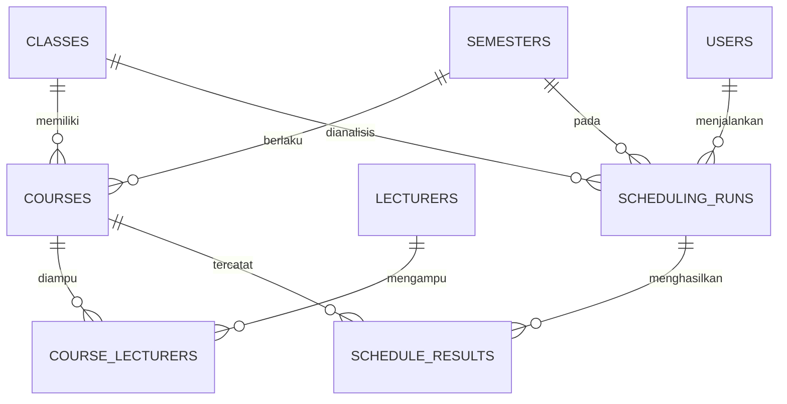

# ClassPlan: Rencana Tahap 1

Status: menunggu persetujuan
Cakupan: kebutuhan, arsitektur, struktur folder, database, UI/UX, API
Belum ada kode aplikasi yang ditulis.

---

## 0. Ringkasan keputusan

| No | Keputusan | Alasan |
|----|-----------|--------|
| 1 | Monorepo npm workspaces: `client`, `server`, `shared` | Skema validasi Zod dipakai bersama, tanpa duplikasi aturan |
| 2 | React 19 + Vite + React Router 7 | Frontend modular, build cepat, routing eksplisit |
| 3 | TanStack Query untuk data server | Cache, invalidasi, dan state loading/error konsisten |
| 4 | Express 5 + `pg` (SQL parameterized) + migrasi SQL | Query terlihat jelas, cocok untuk skripsi yang harus bisa dipertanggungjawabkan |
| 5 | Validasi Zod di `shared/schemas` | Klien dan server memakai aturan yang sama |
| 6 | Algoritma murni di `server/src/algorithm`, tanpa dependensi HTTP/DB | Mudah diuji unit dan dipakai ulang |
| 7 | Trace algoritma dihitung sekali di server, disimpan sebagai JSONB | Pemutar langkah di frontend tidak perlu request per langkah, laporan historis tetap utuh |
| 8 | Snapshot graf + trace + pengaturan disimpan per run | Laporan lama tidak berubah saat data master diedit |
| 9 | React Flow (`@xyflow/react`) untuk graf | 10 simpul, butuh node kustom, drag, dan panel detail |
| 10 | Tailwind CSS v4 (plugin Vite), token desain via CSS variables | Sesuai dokumen, tanpa file konfigurasi berlebih |
| 11 | Auth JWT di cookie httpOnly, satu peran admin | Sederhana, aman dari pencurian token via XSS |
| 12 | PDF lewat print stylesheet (`window.print()`) | Tidak menambah dependensi berat, hasil A4 rapi |

---

## 1. Pemahaman kebutuhan

### 1.1 Aktor

| Aktor | Hak akses |
|-------|-----------|
| Admin | Login, CRUD mata kuliah, CRUD dosen, relasi dosen ke mata kuliah, kelola kelas dan semester, jalankan analisis, lihat hasil, unduh laporan, ubah pengaturan |
| Pengamat (opsional, tidak dibangun di MVP) | Lihat data dan hasil, unduh laporan bila diizinkan |

MVP hanya membangun peran admin. Tabel `users` sudah menyiapkan kolom `role` agar peran pengamat bisa ditambah tanpa migrasi besar.

### 1.2 Alur utama

1. Admin login.
2. Admin memilih konteks kerja: kelas + semester.
3. Admin mengisi atau memperbaiki data mata kuliah dan dosen.
4. Admin membuka Graf Konflik untuk memeriksa simpul, sisi, dan alasan konflik.
5. Admin menjalankan analisis dengan mode konflik dan aturan pemecah seri tertentu.
6. Sistem membentuk graf, menghitung derajat, mengurutkan, mewarnai, dan memvalidasi.
7. Admin memutar ulang proses langkah demi langkah untuk memeriksa transparansi.
8. Admin melihat kelompok warna.
9. Admin membuka laporan, mencetak atau menyimpan PDF, dan mengekspor tabel ke CSV.

### 1.3 Ruang lingkup MVP

- CRUD mata kuliah, dosen, kelas, semester.
- Relasi banyak ke banyak mata kuliah dan dosen.
- Pembentukan graf konflik mode dosen.
- Perhitungan derajat, pengurutan, pewarnaan Welch Powell, validasi.
- Visualisasi graf sebelum dan sesudah pewarnaan.
- Pemutar langkah algoritma.
- Halaman hasil pengelompokan dan laporan.
- Pengaturan institusi dan aturan pemecah seri.

### 1.4 Di luar MVP

- Penempatan hari, jam, ruang, dan durasi.
- Data mahasiswa dan kelompok mahasiswa.
- Mode konflik kelas (lihat temuan B).
- Impor CSV (opsional di dokumen, ditunda).
- Peran pengamat, multi-institusi, dark mode.
- Penjadwalan otomatis lanjutan (dokumen bagian 13).

---

## 2. Temuan dan ketidaksesuaian

Semua temuan di bawah harus diputuskan sebelum coding, karena memengaruhi hasil acuan dan bentuk data.

### A. Urutan Welch Powell tidak cocok dengan hasil acuan (paling penting)

Data pada dokumen: MD 3 SKS, SD 1 SKS, PSD 2 SKS. Ketiganya berderajat 2.

Aturan tertulis di bagian 4.5 dan 6: derajat menurun, lalu SKS menurun, lalu kode menaik.

Hasil aturan tersebut:

```
MD(2,3) > PSD(2,2) > SD(2,1) > DP > KBD > PDP > PKBD > PA > PBN > PC
```

Urutan acuan di dokumen justru:

```
MD, SD, PSD, DP, PDP, KBD, PKBD, PA, PC, PBN
```

Urutan acuan itu hanya konsisten dengan dua kemungkinan:

1. Pengurutan dilakukan **hanya** berdasarkan derajat menurun dengan urutan data awal dipertahankan saat seri (MD, SD, PSD adalah urutan tabel), tanpa aturan SKS dan kode.
2. SKS SD sebenarnya **3**, bukan 1. Dengan SD = 3 SKS, aturan tertulis menghasilkan persis urutan acuan.

Perbandingan hasil pewarnaan:

| Skenario | Urutan | Warna 1 | Warna 2 | Warna 3 | Jumlah warna |
|----------|--------|---------|---------|---------|--------------|
| A1: aturan tertulis apa adanya | MD, PSD, SD, DP, KBD, PDP, PKBD, PA, PBN, PC | MD, DP, KBD, PA, PBN, PC | PSD, PDP, PKBD | SD | 3 |
| A2: urutan acuan (tanpa SKS/kode) | MD, SD, PSD, ... | MD, DP, KBD, PA, PBN, PC | SD, PDP, PKBD | PSD | 3 |
| A3: SD = 3 SKS, aturan tertulis | MD, SD, PSD, ... | MD, DP, KBD, PA, PBN, PC | SD, PDP, PKBD | PSD | 3 |

Ketiga skenario menghasilkan 3 warna dan tetap optimal, karena MD, SD, PSD membentuk klik K3 sehingga batas bawahnya 3. Perbedaannya hanya pada isi kelompok 2 dan 3.

Rekomendasi: konfirmasi SKS SD ke sumber akademik. Bila SD memang 3 SKS, pakai A3 dan perbaiki data seed. Bila SD tetap 1 SKS, pakai A1 dan perbaiki tabel hasil acuan di dokumen. Jangan memakai A2, karena aturan pemecah seri yang ditampilkan ke pengguna akan berbeda dari yang benar-benar dijalankan.

### B. Mode konflik kelas menghasilkan graf lengkap

Dokumen bagian 2.2 sudah mencatat masalah ini. Bila seluruh mata kuliah diambil kelompok mahasiswa yang sama pada semester yang sama, semua pasangan berkonflik, graf menjadi K10, dan hasilnya 10 warna. Angka itu benar secara teori tetapi tidak berguna sebagai hasil penjadwalan, dan berpotensi disalahartikan saat sidang.

Mode ini juga tidak bisa diuji dengan data studi kasus, karena data studi kasus tidak memuat kelompok mahasiswa atau slot waktu.

Rekomendasi: MVP hanya membangun mode `lecturer`. Kolom `conflict_mode` tetap menyediakan nilai `lecturer_class` agar bisa diaktifkan nanti setelah ada definisi slot waktu atau kelompok mahasiswa yang lebih sempit. Opsi mode kedua tidak ditampilkan sebagai tombol mati, tetapi dijelaskan di halaman Pengaturan sebagai batasan versi ini.

### C. Warna bukan jadwal

Seluruh label UI memakai kata "kelompok", bukan "hari" atau "jam". Halaman hasil menampilkan catatan tetap: kelompok warna berarti tidak ada dosen yang bentrok di dalam kelompok, bukan bahwa mata kuliah tersebut sudah punya waktu kuliah.

### D. Cakupan keunikan kode mata kuliah

Dokumen: kode unik dalam semester. Bila satu semester punya dua kelas yang sama-sama menawarkan kode MD, aturan itu gagal. Rancangan ini memakai unik pada (`code`, `class_id`, `semester_id`). Untuk MVP satu kelas hasilnya sama, tetapi aman saat kelas bertambah.

### E. Endpoint graf

Dokumen menyarankan `POST /api/graph/build`. Pratinjau graf tidak mengubah data, jadi lebih tepat `GET /api/graph?classId=&semesterId=&mode=`. Graf yang tersimpan tetap diambil dari run lewat `GET /api/scheduling-runs/:id`.

### F. Integritas riwayat

`schedule_results.course_id` memakai `ON DELETE SET NULL`, dan kode serta nama mata kuliah disalin ke baris hasil. Snapshot graf dan trace disimpan sebagai JSONB. Dengan begitu, menghapus mata kuliah tidak merusak laporan lama.

### G. Tema

Dokumen meminta tampilan terang, bersih, dan berorientasi cetak. MVP hanya mengirim satu tema terang. Tidak ada tombol dark mode setengah jadi, karena laporan utama berakhir di kertas.

---

## 3. Arsitektur

### 3.1 Gambaran

```
Browser (React SPA)
   |  fetch JSON, cookie httpOnly
   v
Express API  ---->  PostgreSQL
   |
   +--> modul algoritma murni (graph, ordering, coloring, validation)
```

Frontend tidak pernah menghitung hasil akhir. Frontend hanya memutar trace yang dikirim server, sehingga tampilan dan laporan memakai sumber kebenaran yang sama.

### 3.2 Frontend

- Vite, React 19, React Router 7.
- TanStack Query untuk semua data server: cache per query key, invalidasi setelah mutasi.
- React Hook Form + resolusi Zod dari `shared`.
- State lokal hanya untuk hal UI: modal terbuka, langkah trace aktif, filter tabel.
- Pemutar langkah membaca array `trace` yang sudah lengkap. Tidak ada request per langkah.
- Semua panggilan API lewat satu modul `api/client.js` yang menangani error, 401, dan format respons.

### 3.3 Backend

- Express 5, ESM, Node 20+.
- Lapisan per modul: `routes` (HTTP, validasi), `service` (aturan bisnis + SQL), `algorithm` (fungsi murni).
- Satu `errorHandler` terpusat, satu format error.
- `pg.Pool` tunggal, semua query parameterized.
- Migrasi berupa file SQL berurutan, dijalankan oleh `npm run db:migrate`.
- Seed data studi kasus terpisah dari migrasi.

### 3.4 Auth dan keamanan

- `POST /api/auth/login` memverifikasi bcryptjs, menerbitkan JWT 8 jam di cookie `httpOnly`, `sameSite=lax`, `secure` di produksi.
- `helmet`, `cors` dengan origin klien, rate limit pada login.
- Middleware `requireAuth` dan `requireRole('admin')`.
- Tidak ada registrasi mandiri. Admin awal dibuat oleh `npm run db:seed` dari variabel lingkungan.
- Di development, Vite mem-proxy `/api` ke port API sehingga cookie tetap same-origin.

### 3.5 Alur satu analisis

```
POST /api/scheduling-runs
  validasi payload
  ambil courses + lecturers pada scope
  tolak bila ada mata kuliah tanpa dosen (mode lecturer)
  buildGraph()      -> vertices, edges + alasan, degrees
  orderVertices()   -> urutan + alasan comparator
  welshPowell()     -> warna + trace
  validateColoring() -> status + konflik (harus kosong)
  lowerBound()      -> clique maksimum, status optimalitas
  simpan scheduling_runs + schedule_results
  kembalikan ringkasan + runId
```

Semua langkah berjalan di satu transaksi. Bila gagal, tidak ada run setengah jadi.

---

## 4. Struktur folder

```
ClassPlan/
  package.json                 # workspaces + script root
  .env.example
  README.md
  docs/
    01-rencana.md
    DESIGN.md
  shared/
    package.json
    src/
      index.js
      schemas/
        auth.js
        course.js
        lecturer.js
        class.js
        semester.js
        settings.js
        run.js
      constants/
        conflictModes.js
        tieBreakRules.js
        limits.js
  server/
    package.json
    src/
      index.js                 # bootstrap http server
      app.js                   # express app, middleware, router
      config/env.js
      db/
        pool.js
        migrate.js
        seed.js
      migrations/
        001_init.sql
      middleware/
        auth.js
        validate.js
        errorHandler.js
        notFound.js
      modules/
        auth/        auth.routes.js, auth.service.js
        courses/     courses.routes.js, courses.service.js
        lecturers/   lecturers.routes.js, lecturers.service.js
        classes/     classes.routes.js, classes.service.js
        semesters/   semesters.routes.js, semesters.service.js
        settings/    settings.routes.js, settings.service.js
        dashboard/   dashboard.routes.js, dashboard.service.js
        graph/       graph.routes.js, graph.service.js
        runs/        runs.routes.js, runs.service.js, runs.report.js
      algorithm/
        buildGraph.js
        ordering.js
        welshPowell.js
        validateColoring.js
        maxClique.js
        trace.js
      utils/
        errors.js
        csv.js
        asyncHandler.js
    tests/
      buildGraph.test.js
      ordering.test.js
      welshPowell.test.js
      validation.test.js
      caseStudy.test.js
  client/
    package.json
    vite.config.js
    index.html
    src/
      main.jsx
      App.jsx
      routes.jsx
      styles/index.css
      api/
        client.js
        auth.js
        courses.js
        lecturers.js
        classes.js
        semesters.js
        settings.js
        dashboard.js
        graph.js
        runs.js
      hooks/
        useScope.js
        useCourses.js
        useLecturers.js
        useRun.js
        useDashboard.js
      components/
        layout/    AppShell.jsx, Sidebar.jsx, Topbar.jsx, ScopePicker.jsx
        ui/        Button.jsx, Input.jsx, Select.jsx, Modal.jsx, ConfirmDialog.jsx,
                   DataTable.jsx, Badge.jsx, EmptyState.jsx, ErrorState.jsx,
                   Skeleton.jsx, Toast.jsx, Field.jsx
        graph/     ConflictGraph.jsx, CourseNode.jsx, GroupLegend.jsx, GraphToolbar.jsx
        analysis/  StepRail.jsx, PlayerControls.jsx, TraceLog.jsx, OrderTable.jsx
        report/    ReportLayout.jsx, ReportSection.jsx
      pages/
        LoginPage.jsx
        DashboardPage.jsx
        CoursesPage.jsx
        LecturersPage.jsx
        GraphPage.jsx
        AnalysisPage.jsx
        ResultsPage.jsx
        ReportPage.jsx
        SettingsPage.jsx
        NotFoundPage.jsx
      lib/
        format.js
        colors.js
        csv.js
        print.js
```

Aturan dependensi: `algorithm` tidak mengimpor Express, DB, atau `shared` yang berisi I/O. `routes` tidak menulis SQL. Halaman tidak memanggil `fetch` langsung.

---

## 5. Database

### 5.1 ERD



### 5.2 Tabel

`users`: `id`, `name`, `email`, `password_hash`, `role`, timestamps. Unik pada `lower(email)`.

`classes`: `id`, `name`, `study_program`, timestamps. Unik (`name`, `study_program`).

`semesters`: `id`, `academic_year`, `term` (`ganjil`/`genap`), timestamps. Unik (`academic_year`, `term`).

`courses`: `id`, `code`, `name`, `credits`, `class_id`, `semester_id`, timestamps. Unik (`code`, `class_id`, `semester_id`). `credits > 0`.

`lecturers`: `id`, `name`, `lecturer_code` (opsional), timestamps. Indeks unik parsial pada `lower(lecturer_code)`.

`course_lecturers`: `id`, `course_id`, `lecturer_id`. Unik (`course_id`, `lecturer_id`). Hapus mata kuliah ikut menghapus relasi, hapus dosen ditolak bila masih terpakai.

`scheduling_runs`: `id`, `class_id`, `semester_id`, `conflict_mode` (`lecturer`, `lecturer_class`), `tie_break_rule` JSONB, `status`, `vertex_count`, `edge_count`, `color_count`, `validation_status` (`valid`/`invalid`), `graph_snapshot` JSONB, `trace` JSONB, `settings_snapshot` JSONB, `created_by`, `created_at`.

`schedule_results`: `id`, `run_id`, `course_id` (nullable, `ON DELETE SET NULL`), `course_code`, `course_name`, `color_number`. Unik (`run_id`, `course_code`).

`app_settings`: satu baris (`id = 1`), `institution_name`, `study_program`, `academic_year`, `term`, `default_conflict_mode`, `tie_break_rule`, `updated_at`.

### 5.3 DDL inti

```sql
create table classes (
  id            bigserial primary key,
  name          text not null,
  study_program text not null,
  created_at    timestamptz not null default now(),
  updated_at    timestamptz not null default now(),
  unique (name, study_program)
);

create table semesters (
  id            bigserial primary key,
  academic_year text not null,
  term          text not null check (term in ('ganjil', 'genap')),
  created_at    timestamptz not null default now(),
  updated_at    timestamptz not null default now(),
  unique (academic_year, term)
);

create table courses (
  id          bigserial primary key,
  code        text not null,
  name        text not null,
  credits     smallint not null check (credits > 0),
  class_id    bigint not null references classes(id) on delete restrict,
  semester_id bigint not null references semesters(id) on delete restrict,
  created_at  timestamptz not null default now(),
  updated_at  timestamptz not null default now(),
  unique (code, class_id, semester_id)
);
create index courses_scope_idx on courses (class_id, semester_id);

create table lecturers (
  id            bigserial primary key,
  name          text not null,
  lecturer_code text,
  created_at    timestamptz not null default now(),
  updated_at    timestamptz not null default now()
);
create unique index lecturers_code_uidx
  on lecturers (lower(lecturer_code)) where lecturer_code is not null;

create table course_lecturers (
  id          bigserial primary key,
  course_id   bigint not null references courses(id) on delete cascade,
  lecturer_id bigint not null references lecturers(id) on delete restrict,
  unique (course_id, lecturer_id)
);
create index course_lecturers_lecturer_idx on course_lecturers (lecturer_id);

create table scheduling_runs (
  id                bigserial primary key,
  class_id          bigint not null references classes(id) on delete restrict,
  semester_id       bigint not null references semesters(id) on delete restrict,
  conflict_mode     text not null check (conflict_mode in ('lecturer', 'lecturer_class')),
  tie_break_rule    jsonb not null,
  status            text not null default 'completed' check (status in ('completed', 'failed')),
  vertex_count      int not null,
  edge_count        int not null,
  color_count       int not null,
  validation_status text not null check (validation_status in ('valid', 'invalid')),
  graph_snapshot    jsonb not null,
  trace             jsonb not null,
  settings_snapshot jsonb not null,
  created_by        bigint references users(id) on delete set null,
  created_at        timestamptz not null default now()
);
create index scheduling_runs_scope_idx
  on scheduling_runs (class_id, semester_id, created_at desc);

create table schedule_results (
  id          bigserial primary key,
  run_id      bigint not null references scheduling_runs(id) on delete cascade,
  course_id   bigint references courses(id) on delete set null,
  course_code text not null,
  course_name text not null,
  color_number int not null check (color_number > 0),
  unique (run_id, course_code)
);
create index schedule_results_run_idx on schedule_results (run_id, color_number);
```

### 5.4 Bentuk snapshot

`graph_snapshot`:

```json
{
  "vertices": [
    { "id": 3, "code": "MD", "name": "Matematika Diskrit", "credits": 3, "degree": 2,
      "lecturers": [{ "id": 5, "name": "RR Octanty Mulianingtyas" }] }
  ],
  "edges": [
    { "u": "MD", "v": "SD", "reason": { "type": "lecturer", "lecturers": [5] } }
  ]
}
```

`trace` adalah array kejadian berurutan, lihat bagian 6.5.

---

## 6. Algoritma

### 6.1 buildGraph(vertices, mode)

- Satu simpul per mata kuliah pada scope.
- Untuk setiap pasangan tidak berurutan, buat himpunan irisan dosen. Bila tidak kosong, tambah satu sisi dengan daftar dosen penyebab.
- Sisi dideduplikasi berdasarkan pasangan, bukan berdasarkan dosen, sehingga dosen ganda tidak menghasilkan sisi ganda.
- Mode `lecturer_class` tidak dijalankan di MVP.

### 6.2 orderVertices

Comparator disusun dari rantai aturan yang tersimpan:

1. `degree_desc`
2. `credits_desc`
3. `course_code_asc`

Comparator terakhir selalu `course.id` menaik agar urutan total deterministik walaupun kode sama (tidak mungkin dengan constraint, tetapi menjaga kestabilan). Aturan yang dipakai disimpan di `scheduling_runs.tie_break_rule` dan ditampilkan di UI serta laporan.

### 6.3 welshPowell

```
warna = 0
selama ada simpul belum berwarna:
  warna = warna + 1
  ambil simpul belum berwarna pertama dalam urutan
  beri warna
  untuk setiap simpul berikutnya dalam urutan:
    bila belum berwarna dan tidak bertetangga dengan anggota warna ini:
      beri warna
```

Himpunan anggota warna disimpan agar pengecekan tetangga O(1) per simpul.

Catatan teori: Welch Powell adalah heuristik, bukan penjamin optimum. Kualitas hasil bergantung pada urutan. Karena itu laporan tidak boleh menyebut hasil "paling optimal" kecuali batas bawah membuktikannya.

### 6.4 Validasi dan batas bawah

- Semua simpul tepat satu warna.
- Setiap sisi menghubungkan dua warna berbeda. Bila ada pelanggaran, run ditandai `invalid` dan detailnya disimpan.
- Batas bawah = ukuran klik maksimum (`maxClique`, Bron dan Kerbosch dengan pivot).
- Bila `colorCount == lowerBound`, status `optimal`. Bila tidak, status `belum terbukti optimal` beserta selisihnya.
- Untuk data studi kasus, klik MD, SD, PSD berukuran 3 dan hasilnya 3 warna, sehingga optimalitas terbukti.

### 6.5 Trace

```json
[
  { "step": 1, "type": "GRAPH_BUILT", "vertexCount": 10, "edgeCount": 5 },
  { "step": 2, "type": "DEGREES_COMPUTED", "degrees": [{ "code": "MD", "degree": 2 }] },
  { "step": 3, "type": "ORDERED", "order": ["MD", "PSD", "SD", "DP"] },
  { "step": 4, "type": "COLOR_OPENED", "color": 1, "seed": "MD" },
  { "step": 5, "type": "VERTEX_COLORED", "code": "MD", "color": 1, "reason": "seed" },
  { "step": 6, "type": "VERTEX_SKIPPED", "code": "PSD", "color": 1, "blockedBy": ["MD"] },
  { "step": 7, "type": "VERTEX_COLORED", "code": "DP", "color": 1, "reason": "not_adjacent" },
  { "step": 8, "type": "COLOR_CLOSED", "color": 1, "members": ["MD", "DP"] },
  { "step": 9, "type": "VALIDATED", "isValid": true, "colorCount": 3 }
]
```

`VERTEX_SKIPPED` disertakan agar pengguna bisa melihat alasan sebuah simpul tidak masuk warna tertentu, bukan hanya hasil akhirnya.

### 6.6 Contoh run data studi kasus (skenario A1)

Urutan: MD, PSD, SD, DP, KBD, PDP, PKBD, PA, PBN, PC.

| Warna | Simpul awal | Diterima | Dilewati dan alasan |
|-------|-------------|----------|---------------------|
| 1 | MD | DP, KBD, PA, PBN, PC | PSD (tetangga MD), SD (tetangga MD), PDP (tetangga DP), PKBD (tetangga KBD) |
| 2 | PSD | PDP, PKBD | SD (tetangga PSD) |
| 3 | SD | tidak ada | sudah habis |

Hasil: 3 warna, valid, optimal karena K3.

### 6.7 Matriks uji

| Kasus | Harapan |
|-------|---------|
| Data studi kasus | 10 simpul, 5 sisi, 3 warna, valid, optimal |
| Dua mata kuliah satu dosen | 1 sisi |
| Tiga mata kuliah satu dosen | K3, 3 warna |
| Dosen ganda pada dua mata kuliah | tetap 1 sisi |
| Tanpa sisi (semua dosen berbeda) | 10 simpul, 0 sisi, 1 warna |
| Graf lengkap 5 simpul | 5 warna |
| Derajat sama, SKS sama | urutan kode menaik |
| Derajat sama, SKS beda | SKS besar lebih dulu |
| Mata kuliah tanpa dosen | run ditolak, daftar kode dikembalikan |
| Daftar kosong | 422 dengan pesan jelas |

---

## 7. API

### 7.1 Konvensi

- Base path `/api`.
- JSON, `camelCase` di body dan respons, `snake_case` di database.
- Error selalu berbentuk `{ "error": { "code": "...", "message": "...", "fields": { ... } } }`.
- Status: 400 validasi, 401 belum login, 403 tanpa hak, 404 tidak ada, 409 duplikat, 422 data belum lengkap, 500 server.

### 7.2 Endpoint

| Method | Endpoint | Fungsi |
|--------|----------|--------|
| POST | `/api/auth/login` | Login, set cookie |
| POST | `/api/auth/logout` | Hapus cookie |
| GET | `/api/auth/me` | Sesi aktif |
| GET | `/api/courses` | Daftar, filter `classId`, `semesterId`, `search` |
| GET | `/api/courses/:id` | Detail + dosen |
| POST | `/api/courses` | Tambah |
| PUT | `/api/courses/:id` | Ubah |
| DELETE | `/api/courses/:id` | Hapus |
| PUT | `/api/courses/:id/lecturers` | Ganti himpunan dosen |
| GET | `/api/lecturers` | Daftar, `search` |
| POST | `/api/lecturers` | Tambah |
| PUT | `/api/lecturers/:id` | Ubah |
| DELETE | `/api/lecturers/:id` | Hapus, 409 bila masih dipakai |
| GET | `/api/classes` | Daftar kelas |
| POST | `/api/classes` | Tambah |
| PUT | `/api/classes/:id` | Ubah |
| DELETE | `/api/classes/:id` | Hapus |
| GET | `/api/semesters` | Daftar semester |
| POST | `/api/semesters` | Tambah |
| PUT | `/api/semesters/:id` | Ubah |
| DELETE | `/api/semesters/:id` | Hapus |
| GET | `/api/settings` | Pengaturan aplikasi |
| PUT | `/api/settings` | Simpan pengaturan |
| GET | `/api/dashboard` | Ringkasan scope + run terakhir |
| GET | `/api/graph` | Pratinjau graf, tidak menyimpan |
| POST | `/api/scheduling-runs` | Jalankan Welch Powell |
| GET | `/api/scheduling-runs` | Riwayat run pada scope |
| GET | `/api/scheduling-runs/:id` | Detail run + graf + trace |
| GET | `/api/scheduling-runs/:id/report` | Payload laporan lengkap |
| GET | `/api/scheduling-runs/:id/export.csv` | Ekspor tabel laporan |

### 7.3 Contoh payload run

```json
{
  "classId": 1,
  "semesterId": 1,
  "conflictMode": "lecturer",
  "tieBreakRule": ["degree_desc", "credits_desc", "course_code_asc"]
}
```

Respons 201:

```json
{
  "runId": 12,
  "vertexCount": 10,
  "edgeCount": 5,
  "colorCount": 3,
  "isValid": true,
  "optimality": { "lowerBound": 3, "status": "optimal" },
  "groups": [
    { "color": 1, "courses": ["MD", "DP", "KBD", "PA", "PBN", "PC"] },
    { "color": 2, "courses": ["PSD", "PDP", "PKBD"] },
    { "color": 3, "courses": ["SD"] }
  ]
}
```

Catatan: isi grup mengikuti skenario A1. Bila keputusan berubah, contoh ini ikut berubah.

---

## 8. UI/UX

Rincian token, tipografi, dan aturan komponen ada di `docs/DESIGN.md`.

### 8.1 Kerangka

- Sidebar tetap 248px pada desktop, dapat diciutkan, menjadi drawer pada ponsel.
- Topbar berisi breadcrumb, pemilih scope (kelas + semester), dan menu akun.
- Area kerja putih di atas latar `#F6F7F9`.
- Satu fokus utama per halaman. Pada Dashboard, fokusnya ringkasan run terakhir, bukan deretan kartu angka.

### 8.2 Halaman

**Login**
Form email dan password, satu tombol. Error ditampilkan di atas form. Tidak ada tautan daftar.

**Dashboard**
Pemilih scope, strip ringkas berisi jumlah mata kuliah, dosen, sisi, dan warna run terakhir. Panel besar berisi run terakhir: mode, waktu, status validasi, pratinjau kelompok, tombol "Lihat hasil" dan "Buka laporan". Tombol utama "Jalankan analisis". Bila belum ada run, panel diganti empty state yang mengarahkan ke kelengkapan data.

**Data Mata Kuliah**
Toolbar: pencarian, filter kelas dan semester, tombol "Tambah mata kuliah". Tabel: kode, nama, SKS, kelas, semester, dosen, aksi teks "Ubah" dan "Hapus". Modal form dengan pemilih dosen banyak. Validasi sebaris per field. Konfirmasi hapus menyebut nama mata kuliah.

**Data Dosen**
Tabel: nama, NIDN/NIP, jumlah mata kuliah, aksi. Modal form. Baris dapat dibuka untuk melihat daftar mata kuliah yang diampu.

**Graf Konflik**
Toolbar: scope, mode, tombol "Muat ulang". Kanvas React Flow dengan node kustom berisi kode, nama, derajat. Panel kanan: detail simpul atau detail sisi beserta dosen penyebab. Legenda. Strip statistik |V| dan |E|. Daftar sisi dalam tabel agar informasinya tetap bisa diakses tanpa kanvas. Tombol "Atur ulang tata letak" mengembalikan posisi melingkar.

**Analisis Welch Powell**
Ringkasan data sebelum run, peringatan bila ada mata kuliah tanpa dosen, pilihan aturan pemecah seri, tombol "Jalankan algoritma". Setelah run: rel langkah 1 sampai 5, kanvas graf yang berubah warna, log langkah, tabel urutan dan warna, kontrol "Sebelumnya", "Berikutnya", "Putar otomatis", "Ulangi". Kecepatan putar dipilih dari tiga nilai.

**Hasil Pengelompokan**
Kartu per kelompok dengan nomor, daftar mata kuliah, total SKS, dan daftar dosen. Badge validasi. Catatan tetap bahwa kelompok bukan jadwal. Tautan ke laporan.

**Laporan**
Tata letak cetak A4 dengan 11 bagian sesuai dokumen, header institusi, dan footer nomor halaman. Tombol "Cetak atau simpan PDF" dan "Ekspor CSV". Pratinjau di layar memakai komponen yang sama dengan versi cetak.

**Pengaturan**
Bagian: identitas institusi, tahun akademik dan semester aktif, aturan pemecah seri default, mode konflik default (hanya dosen, dengan penjelasan mode kelas), serta kelola kelas dan semester.

### 8.3 State wajib

Setiap halaman data punya empat state: memuat (skeleton sesuai bentuk konten), kosong (sebab dan aksi berikutnya), galat (apa yang gagal dan tombol coba lagi), dan terisi. Empty state membedakan "belum ada data" dari "filter tidak menemukan apa pun".

### 8.4 Responsif dan aksesibilitas

- Tabel menggulir horizontal dengan kolom kode tetap terlihat.
- Target sentuh minimal 44px.
- Fokus terlihat di semua elemen interaktif, modal dapat ditutup dengan Escape dan mengembalikan fokus.
- Pemutar langkah mengumumkan perubahan lewat `aria-live` dan menghormati `prefers-reduced-motion`.
- Informasi graf selalu punya padanan teks di tabel sisi dan derajat.
- Warna kelompok selalu disertai nomor, tidak pernah menjadi satu-satunya pembeda.

---

## 9. Peta kriteria keberhasilan

| Kriteria dokumen | Bukti |
|------------------|-------|
| CRUD mata kuliah dan dosen | Modul courses dan lecturers + uji API |
| Pembentukan graf sesuai mode | `buildGraph` + uji pasangan dan deduplikasi |
| Derajat dan urutan konsisten | `ordering` + uji seri derajat, SKS, kode |
| Welch Powell berjalan | `welshPowell` + uji K3, graf kosong, graf lengkap |
| Proses dan hasil ditampilkan | Trace + halaman Analisis |
| Validasi warna | `validateColoring` + status pada laporan |
| Laporan | Halaman Laporan + cetak + CSV |
| Hasil studi kasus sesuai acuan | `caseStudy.test.js` membandingkan 3 warna dan isi kelompok |

---

## 10. Rencana implementasi tahap 2

1. Fondasi: workspace, env, migrasi, seed, script dev.
2. Auth dan kerangka UI: login, sidebar, scope picker, guard route.
3. Master data: kelas, semester, dosen, mata kuliah, relasi dosen.
4. Mesin algoritma dan uji unit, lalu endpoint graf dan run.
5. Halaman Graf Konflik.
6. Halaman Analisis dengan pemutar langkah.
7. Halaman Hasil, Laporan, ekspor.
8. Pengaturan dan Dashboard.
9. Pengerasan: state, responsif, aksesibilitas, uji kasus tepi, verifikasi data studi kasus.

Setiap tahap berhenti di titik yang bisa dijalankan dan diperiksa, bukan menumpuk semua perubahan di akhir.

---

## 11. Keputusan yang perlu disetujui

1. Skenario A: A1, A2, atau A3. Rekomendasi A3 bila SKS SD memang 3, jika tidak A1.
2. Mode konflik kelas: tunda ke versi berikutnya, atau tetap dibangun dengan definisi baru.
3. Pembatasan kode mata kuliah: unik per kelas + semester.
4. Laporan PDF lewat print stylesheet, bukan pustaka PDF.
5. Tema terang saja untuk MVP.
6. Setelah poin 1 sampai 5 disetujui, lanjut ke tahap 2 mulai dari fondasi.
